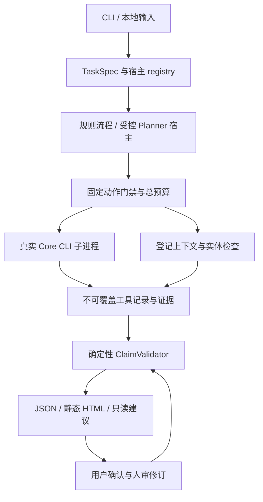

# 当前实现架构

应用使用固定的 VisionLeak Core 0.6.0，依赖在 `.deps/visionleak-core`，原 Core 工作树不参与写操作。指纹、匹配、Core 报告身份和图像复验由既有 Core 实现；Investigator 新增任务目标、上下文、总预算、证据约束、修订和评测组织。

领域契约在 `domain.py` 和 `contracts/`；Core 子进程封装在 `core.py`；生产规则及共用审计操作在 `workflow.py`。`budget.py` 管理工具预留/结算，`model_budget.py` 管理独立的模型请求预算。未知失败保守计费，不能据空 usage 写零费用。

`planner_host.py`、`controller.py`、`planning.py` 提供单 Planner 循环、脱敏观察和固定工具门禁。`openjiuwen_runtime.py` 使用已验证的 SDK 工作流 API。当前可执行的 Planner 来源是明确标注的测试回调，未接入真实模型 provider；不能由“有 Planner 类”推导真实 Agent 已验证。

`metadata.py` 将登记文本视作数据，只在宿主确认目标/字段后检查声明实体的跨 split 重叠。`reporting.py` 根据固定规则验证结论；`presentation.py` 只渲染这些记录，使用转义、路径白名单和本地资源，无页面脚本或远程内容。

`interaction.py` 保存不可覆盖 revision 和累计账本，分别记录当前解释代码与原图像证据代码。`recovery.py` 对已停止的中断运行保守结案，隔离未接纳证据及建议；它不提供 Core 断点扫描。`integrity.py` 绑定已保存的 manifest、报告、账本、证据和恢复收据，并按需调用真实 Core 身份检查。

评测分为独立的宿主与评分边界：`evaluation_data.py` 管来源分组/冻结，`evaluation_runner.py` 按预登记顺序启动 A/B/C 工作进程，`evaluation_scoring.py` 在独立进程读取 evaluator 真值。规则/Planner 工具不接收真值。此隔离针对应用数据流，不限制拥有同一操作系统权限的管理员阅读文件。

部署范围为本地 CLI 和静态文件，没有账户系统、云端数据上传或通用工具插件。Linux CI 额外禁用业务执行网络；macOS 运行不宣称 OS 网络沙箱。进程组超时和 Core 输入限额是实际控制，进程树 RSS 是测量而非硬内存配额。

设计原文保存在 `docs/planning/`；实现选择和偏差在 `docs/adr/`。研究对照的 D 与策略优化 E 仍未执行。

`plan_check.py` 提供生成器与独立 CLI 共用的清单检查；绑定已验证的审计/输入，保留已知冲突与覆盖边界。它不执行文件修改或图像重审，也不改变原审计账本。

`proposal_export.py` 只从有效证据重新生成建议，CSV 文本采用可还原编码。`interaction_evaluation.py` 单独组织 C/D 交互任务与固定回答通道，`interaction_scoring.py` 在独立进程读取交互真值；初始/续答工作进程不接收完整回答契约或风险标签。
